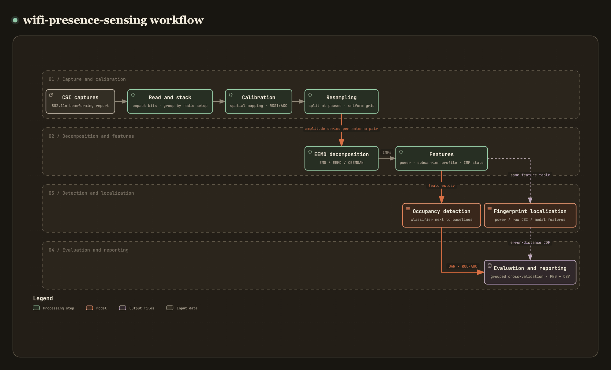

# wifi-presence-sensing

[](https://github.com/recklight/wifi-presence-sensing/actions/workflows/ci.yml)
[](https://www.python.org/downloads/)
[](LICENSE)

English | [繁體中文](README.zh-TW.md)

Indoor occupancy detection and fingerprint localization from WiFi channel state information (CSI).

It takes the raw beamforming reports that an 802.11n NIC records through to cross-validated occupancy detection and the cumulative distribution of localization errors. On the way it unpacks the bit-packed CSI, undoes the transmitter's spatial mapping, calibrates the amplitude to an absolute scale with RSSI/AGC and resamples the irregularly spaced packets onto a uniform time grid. Ensemble empirical mode decomposition (EEMD) then splits the CSI amplitude time series of every antenna pair into intrinsic mode functions (IMFs), and the features are computed from those IMFs. The Python package is `wifi_presence_sensing`; the command-line tool is `wifi-presence-sensing`.

Author: RL

---

## Contents

- [Overview](#overview)
- [Method](#method)
- [Installation](#installation)
- [Quick start](#quick-start)
- [Usage](#usage)
- [CLI reference](#cli-reference)
- [Project layout](#project-layout)
- [Data preparation](#data-preparation)
- [Configuration](#configuration)
- [Results and metrics](#results-and-metrics)
- [Known limitations](#known-limitations)
- [Design notes](#design-notes)
- [Development and testing](#development-and-testing)
- [References](#references)
- [License](#license)

---

## Overview

[](https://raw.githack.com/recklight/wifi-presence-sensing/master/docs/workflow.html?theme=dark)

Interactive diagram: [view it online](https://raw.githack.com/recklight/wifi-presence-sensing/master/docs/workflow.html?theme=dark), or open [`docs/workflow.html`](docs/workflow.html) locally in a browser. You can zoom, search for a node and trace the path between any two steps.

A person moving through a room changes the multipath structure of the radio signal. That change hardly shows in the *average* CSI amplitude (an occupied and an empty room often differ by less than 1 dB). It shows in how the amplitude *varies* over time: by how much, at which time scales, and whether the subcarriers vary together. EEMD splits a nonlinear, non-stationary time series by time scale, which is why I build the features on it. Yousefi et al. (2017) give an overview of sensing human behaviour with WiFi CSI.

| Stage | What it does | Module |
| --- | --- | --- |
| 1. Reading | Parses the bit packing of the beamforming report, applies the receive-antenna permutation, handles the 32-bit timestamp wrap | `wifi_presence_sensing.capture` |
| 2. Stacking | Groups packets by radio setup (bandwidth, transmit chains, receive chains) and refuses to stack tensors of different shapes | `wifi_presence_sensing.capture.trace` |
| 3. Calibration | Undoes the spatial mapping, estimates the noise floor robustly, calibrates to an absolute scale with RSSI/AGC, computes the effective SNR | `wifi_presence_sensing.calibrate` |
| 4. Resampling | Detects pauses and splits there, resamples each segment onto a uniform grid, reports the effective sampling rate | `wifi_presence_sensing.calibrate.resample` |
| 5. Decomposition | EMD/EEMD/CEEMDAN with a choice of stopping criteria | `wifi_presence_sensing.decompose` |
| 6. Features | Received power, time-averaged amplitude, subcarrier profile, statistics of every IMF | `wifi_presence_sensing.features` |
| 7. Detection | Occupancy classifier, always compared side by side with baselines | `wifi_presence_sensing.occupancy` |
| 8. Localization | Three fingerprint locators (received power, raw CSI, modal features) behind one interface | `wifi_presence_sensing.localize` |
| 9. Evaluation | Grouped stratified cross-validation, UAR/sensitivity/specificity/ROC-AUC, error-distance CDF with bootstrap confidence intervals | `wifi_presence_sensing.evaluate` |
| 10. Reporting | PNG figures, each with a CSV of the data it plots, and a run manifest for every run | `wifi_presence_sensing.report` |

---

## Method

### 1. Unpacking the beamforming report

A capture file is a sequence of frames: a 2-byte big-endian length, a 1-byte type code (`0xBB` for a beamforming report), then the payload. The first 20 bytes of the payload are a little-endian header (timestamp, number of receive chains $N_{rx}$, number of transmit chains $N_{tx}$, three RSSI values, noise floor, AGC, antenna selection, CSI length, rate-and-flags field), followed by the bit-packed CSI: 30 subcarrier groups, each of which first skips 3 bits and then holds $N_{tx}N_{rx}$ complex values, each an 8-bit signed real part followed by an 8-bit signed imaginary part, LSB first. Because of the 3-bit shift, most values straddle a byte boundary:

$$
v = \big((b_k \gg r) \;|\; (b_{k+1} \ll (8-r))\big) \bmod 2^8,\qquad k = \lfloor p/8 \rfloor,\; r = p \bmod 8,
$$

where $p$ is the starting bit of the value. `unpack_csi()` computes $p$ for all values at once and decodes the whole block with array operations, without a loop over bits. The CSI length field must equal

$$
L = \left\lceil \frac{30\,(16 N_{tx} N_{rx} + 3)}{8} \right\rceil ,
$$

and frames that do not match are logged and skipped, as are truncated frames; one bad record does not stop the reader. The antenna-selection byte says which physical antenna the $i$-th reported column came from, and the reader always reorders the columns back into physical order; otherwise "antenna pair $k$" would mean different antennas in different packets. In the rate-and-flags field the reader looks at the CCK flag only for non-HT frames; in an HT frame the low byte is the MCS index (MCS 15 = `0x0F`).

### 2. Undoing the spatial mapping

An 802.11n transmitter may multiply the spatial streams by a spatial mapping matrix $Q$ on their way to the antennas (IEEE Std 802.11n-2009). The channel the receiver estimates is then $M = HQ$, so the physical channel is $H = MQ^{-1}$. If $Q$ is unitary, $Q^{-1} = Q^{H}$ (the **conjugate** transpose). I store the CSI transmitter-first, $C = M^{T}$, so the inversion is

$$
C_{\text{true}} = Q^{-T} C = \overline{Q}\,C ,
$$

and `undo_spatial_mapping()` handles every subcarrier and packet in one `numpy.einsum` call. The conjugate only matters for a complex $Q$. For the real two-stream Hadamard matrix the plain transpose gives the same result, but for the three-stream DFT matrix (whose entries contain $e^{\pm 2\pi i/3}$) it does not, which is why the tests check the inversion on three streams. A matrix that is not unitary is inverted with the Moore–Penrose pseudoinverse, and a warning is logged.

### 3. Amplitude calibration and the noise model

The magnitude of the reported complex values follows the AGC, and the AGC jumps by several dB between packets; without calibration, a decomposition takes the AGC steps for genuine low-frequency modes. The total received power follows from the per-chain RSSI:

$$
P_{rx}\,[\mathrm{dBm}] = 10\log_{10}\Big(\sum_{c} 10^{\mathrm{RSSI}_c/10}\Big) - 44 - \mathrm{AGC},
$$

and the CSI is scaled so that the mean power per subcarrier equals $P_{rx}$:

$$
s = \frac{10^{P_{rx}/10}}{\tfrac{1}{N_{sc}}\sum |C|^2},\qquad C_{\text{abs}} = \sqrt{s}\,C .
$$

Dividing further by the noise power (thermal noise plus 8-bit quantization noise) gives CSI in SNR units. The 44 dB RSSI offset, the quantization-noise term and the power correction for several transmit chains follow the calibration published with the Linux 802.11n CSI Tool (Halperin et al., 2011). The noise field the card reports is unreliable, so `NoiseModel` has three strategies: `reported` (taken as is), `sentinel_guard` (`-127` replaced by `-92 dBm`) and the default `robust`, which first replaces `-127` the same way, then uses a Hampel identifier (Hampel, 1974; Liu et al., 2004) to replace values more than $3.5 \times 1.4826 \times \mathrm{MAD}$ away from the median with the median, and finally clamps the result to a plausible range. All three strategies report the fraction of packets they replaced.

### 4. Effective SNR

The arithmetic mean of the per-subcarrier SNR does not predict how a link performs, because one subcarrier in a deep fade causes far more bit errors than the strong subcarriers save. The effective SNR (Halperin et al., 2010) averages in the bit-error-rate (BER) domain and maps the result back to an SNR:

$$
\gamma_{\text{eff}} = \mathrm{BER}_m^{-1}\Big(\frac{1}{K}\sum_{k=1}^{K}\mathrm{BER}_m(\gamma_k)\Big).
$$

The BER of each modulation uses the Gray-coded approximations for an uncoded AWGN channel (Proakis & Salehi, 2008):

| Modulation | BER (linear SNR per symbol $\gamma$) |
| --- | --- |
| BPSK | $Q(\sqrt{2\gamma}) = \tfrac12\,\mathrm{erfc}(\sqrt{\gamma})$ |
| QPSK | $Q(\sqrt{\gamma})$ |
| 16-QAM | $\tfrac34\,Q(\sqrt{\gamma/5})$ |
| 64-QAM | $\tfrac{7}{12}\,Q(\sqrt{\gamma/21})$ |

At high SNR the BER underflows to 0 (about $10^{-436}$ for BPSK at 30 dB), and the inverse becomes infinite. So `ModulationModel` also has the logarithm of the BER (`scipy.special.log_ndtr` and its inverse `scipy.special.ndtri_exp`), and `effective_snr()` averages in the log domain with log-sum-exp; SNRs from $10^{-3}$ to $10^{4}$ then convert back and forth accurately (the tests allow a relative error of $10^{-9}$). The SNR of every subcarrier and spatial stream comes from a linear MMSE receiver: $\gamma_s = 1/[(I + H^{H}H)^{-1}]_{ss} - 1$.

### 5. Uniform resampling

EMD, the Hilbert transform and every spectral feature assume uniform sampling, but packet capture produces millisecond bursts mixed with pauses of several seconds. `resample_uniform()` first splits the trace at pauses longer than `max_gap_s` (what happened during a pause is unknown, so nothing is interpolated across it) and puts each segment on its own uniform grid: when the native packet rate (from the median packet interval) is more than twice the target rate, it averages the packets in each bin, which doubles as anti-aliasing; otherwise it interpolates linearly. `sampling_diagnostics()` reports the median and long-run sampling rates, the Nyquist frequency, the burst fraction and the number of pauses, and states whether breathing (0.2–0.5 Hz, see Liu et al., 2014), limb motion (0.5–5 Hz) and walking Doppler (above 5 Hz) can be resolved at that rate. The walking Doppler comes from the moving body: a reflector moving at speed $v$ changes the path length so that the amplitude fluctuates at $2v/\lambda$ (Wang et al., 2015).

### 6. EMD, EEMD and CEEMDAN

**EMD** (Huang et al., 1998) writes a signal as a sum of IMFs and a residual trend:

$$
x(t) = \sum_{k=1}^{K} c_k(t) + r(t).
$$

Each IMF comes from sifting: find all maxima and minima, interpolate each set with a natural cubic spline into the upper and lower envelopes $e_{\max}, e_{\min}$, take $m(t) = \tfrac12(e_{\max} + e_{\min})$, set $h = x - m$ and repeat until the stopping criterion accepts. The ends are handled by mirroring extrema (Rilling et al., 2003), so the splines do not swing out at either end of the record. There are three stopping criteria to choose from:

- `ThreeThresholdStopping` (default): $\sigma(t) = |m(t)|/a(t)$, with $\sigma < \theta_1$ except on a fraction $\alpha$ of the samples and $\sigma < \theta_2$ everywhere ($\theta_1 = 0.05$, $\theta_2 = 0.5$, $\alpha = 0.05$);
- `CauchyStopping`: $\sum (h_{k-1}-h_k)^2 / \sum h_{k-1}^2 < 0.2$;
- `FixedIterationStopping`: a fixed number of sifting steps (Wu & Huang's recommendation for EEMD).

Whatever the criterion, each IMF is capped at `max_sift_iterations` (default 1000) sifting steps, so sifting cannot loop forever.

**EEMD** (Wu & Huang, 2009) uses added noise against mode mixing:

$$
x_i(t) = x(t) + \varepsilon\,\sigma_x\,w_i(t),\qquad
\bar c_k(t) = \frac{1}{N}\sum_{i=1}^{N} c_k^{(i)}(t),
$$

and what is left of the added white noise falls off as $\varepsilon/\sqrt{N}$. Each member draws its noise from its own child stream of `numpy.random.SeedSequence(seed)`, so the result depends only on `seed` and not on `n_jobs` (the number of parallel workers). The `paired_noise` option uses both $\pm w_i$ (Yeh et al., 2010), so the noise cancels exactly in the sum of all modes. The residual is defined as $x - \sum_k \bar c_k$, which makes the reconstruction of a clean signal exact; the noise that did not cancel is reported separately as `residual_noise`.

**CEEMDAN** (Torres et al., 2011) extracts the modes one at a time, with all members sharing one residual, so the decomposition is complete and every member has the same mode order. The first mode is extracted with added white noise of standard deviation `noise_scale` $\times\,\sigma_x$; mode $k+1$ is extracted with the $k$-th EMD mode of the noise, $E_k(w_i)$, normalized to unit standard deviation and then multiplied by `noise_scale` and the standard deviation of the current residual $r_k$. This follows Colominas et al. (2014) in scaling the noise with the residual, except that the noise modes are normalized first, so the noise-to-residual ratio does not shrink as the higher noise modes get weaker.

### 7. Features

Every time window yields four named feature groups, and a model picks the groups it uses by their prefix:

| Prefix | Content |
| --- | --- |
| `power__` | Mean and standard deviation of the received power of every receive chain and of the total |
| `response__` | Time-averaged dB amplitude of every (antenna pair, subcarrier), plus the overall mean `response__mean_db` |
| `profile__` | Per antenna pair: temporal standard deviation (mean/maximum), frequency selectivity, spectral range, mean correlation between subcarriers |
| `modal__` | Per antenna pair, the subcarriers are first projected onto their first principal component (PCA), giving one series. After EEMD, each IMF contributes its variance, its energy fraction, its zero-crossing rate and its mean instantaneous frequency (from the Hilbert transform, weighted by instantaneous power, i.e. amplitude squared); the slope of the residual trend is added as well |

### 8. Occupancy detection and fingerprint localization

`OccupancyClassifier` is a scikit-learn (Pedregosa et al., 2011) estimator: it selects feature groups, standardizes them and passes them to logistic regression, a random forest, an SVM or an MLP (or to `majority`, which only votes for the majority class). Evaluation always reports it next to three baselines: the majority-class vote (`majority`), logistic regression on the single mean-amplitude feature (`mean_amplitude`), and the same kind of model as the classifier (`occupancy.model`) trained on the time-averaged amplitudes only (`raw_response`).

Fingerprint localization builds a radio map (the mean and spread of the features at every reference position) and matches against it in one of two ways:

- `knn`: the nearest reference points in signal space (RADAR, Bahl & Padmanabhan, 2000), with every feature measured in units of its pooled within-position standard deviation and neighbour weights $\exp\!\big(-\tfrac12(d_j^2 - d_{\min}^2)\big)$;
- `probabilistic`: every feature at every reference position is modelled as an independent Gaussian, and the estimate is the posterior-weighted position (the probabilistic matching of Horus, Youssef & Agrawala, 2005).

The person being located carries no device: the radio map is measured with a person standing at each reference position between a fixed transmitter and receiver, which makes this device-free CSI fingerprinting (Pilot, Xiao et al., 2013). Using the CSI amplitude of every subcarrier as the fingerprint instead of a single received power is the approach of FIFS (Xiao et al., 2012); FILA (Wu et al., 2012) and Sen et al. (2012) also localize with PHY-layer CSI.

The three locators `ReceivedPowerLocator` (`power`), `RawResponseLocator` (`response`) and `ModalResponseLocator` (`modal` + `profile`) share one algorithm and differ only in the features they see, so any difference between them comes from the features alone.

---

## Installation

Requires Python 3.10 or later (tested on 3.10–3.13).

```bash
git clone https://github.com/recklight/wifi-presence-sensing.git
cd wifi-presence-sensing
python -m venv .venv
source .venv/bin/activate          # Windows: .venv\Scripts\activate
pip install -e .                   # core dependencies: numpy scipy scikit-learn pandas matplotlib pyyaml typer joblib
pip install -e ".[dev]"            # adds pytest, hypothesis, ruff
```

The signal processing is plain NumPy/SciPy, and the binary capture format is parsed with the standard library's `struct` and NumPy.

It also runs from a source checkout without installing: add `src` to `PYTHONPATH` and replace every `wifi-presence-sensing` below with `python -m wifi_presence_sensing`, for example:

```bash
PYTHONPATH=src python -m wifi_presence_sensing --help        # Windows PowerShell: $env:PYTHONPATH="src"
```

---

## Quick start

No measurements needed: run the whole pipeline on simulated captures first.

```bash
wifi-presence-sensing synthesize data/synthetic/occupancy --sessions 4 --duration 40
wifi-presence-sensing prepare --dataset data/synthetic/occupancy/manifest.yaml --config configs/quick_demo.yaml --out outputs/demo
wifi-presence-sensing evaluate outputs/demo/features.csv --config configs/quick_demo.yaml
```

Or run the full demo script (about a minute, detection and localization):

```bash
python examples/end_to_end_synthetic.py --output examples/output
```

In the simulated data the person's effect on the channel is made deliberately obvious, so the demo results only show that the code works, not what accuracy a real room allows.

---

## Usage

### CLI

```bash
# 1. Inspect a capture: packets, radio setup, what the sampling rate can resolve, noise-field quality, effective SNR
wifi-presence-sensing inspect data/raw/session1/occupied.dat

# 2. Build the feature table from a dataset manifest (calibrate -> resample -> window -> EEMD -> features)
#    my_office.yaml is the manifest you write for your own captures; see configs/datasets/example_occupancy.yaml
wifi-presence-sensing prepare --dataset configs/datasets/my_office.yaml --out outputs/office

# 3. Grouped cross-validation: the classifier next to the three baselines
wifi-presence-sensing evaluate outputs/office/features.csv --set evaluation.group_by=session

# 4. Train on all data and save the model, then predict on new data
wifi-presence-sensing train outputs/office/features.csv --model-out outputs/office/model.joblib
wifi-presence-sensing predict outputs/office/model.joblib outputs/new_day/features.csv --out outputs/new_day/predictions.csv

# 5. Fingerprint localization: error-distance CDFs of the three locators
wifi-presence-sensing localize outputs/grid/features.csv --set localization.method=probabilistic

# 6. EEMD decomposition and figure for one antenna pair
wifi-presence-sensing decompose data/raw/session1/occupied.dat --stream tx0rx1
```

Any setting can be overridden for one run with `--set section.key=value`, for example `--set decomposition.n_ensemble=100`.

### Python API

```python
from wifi_presence_sensing import (
    Config, DatasetManifest, read_beamform_file, stack_snapshots,
    standard_mapping_matrix, undo_spatial_mapping, to_calibrated_csi,
    amplitude_db, decompose_eemd,
)
from wifi_presence_sensing.pipeline import build_dataset, evaluate_occupancy, occupancy_summary

# Low level: read, undo the spatial mapping, calibrate, run EEMD on one amplitude series
snapshots, stats = read_beamform_file("data/raw/session1/occupied.dat")
trace, report = stack_snapshots(snapshots, tx_policy="dominant")
# Only undo the mapping if you know the transmitter used it (the config default is none)
csi = undo_spatial_mapping(trace.csi, standard_mapping_matrix(trace.n_tx))
calibrated = to_calibrated_csi(csi, trace.rssi_db, trace.agc_db)      # absolute scale (sqrt(mW))
series = amplitude_db(calibrated)[:, 0, 0, :].mean(axis=1)            # tx0-rx0, mean over subcarriers
result = decompose_eemd(series, n_ensemble=100, noise_scale=0.2, seed=42)
print(result.imfs.shape, abs(result.reconstruct() - series).max())

# High level: whole dataset -> feature table -> grouped cross-validation
config = Config.from_yaml("configs/default.yaml").override({"decomposition.n_ensemble": 20})
manifest = DatasetManifest.from_yaml("configs/datasets/my_office.yaml")
table, details = build_dataset(manifest, config)
reports = evaluate_occupancy(table, config)
print(occupancy_summary(reports))
```

(The time series above is not resampled onto a uniform grid; it only shows the API. For real analysis use `build_dataset()`, which splits at pauses and resamples first.)

---

## CLI reference

| Command | Purpose | Main outputs |
| --- | --- | --- |
| `wifi-presence-sensing inspect CAPTURE...` | Parses captures and reports packets, radio setup, sampling limits, noise field and effective SNR | `inspection.json`, a packet-interval histogram per capture (`<stem>_intervals.png`) and its data (`<stem>_intervals.csv`); when file names repeat, the folder name goes in front, e.g. `session1_occupied_intervals.png` |
| `wifi-presence-sensing synthesize DIR` | Writes simulated captures and a dataset manifest (no real data involved) | `*.dat`, `manifest.yaml` |
| `wifi-presence-sensing prepare --dataset M` | Builds the feature table from a dataset manifest | `features.csv` |
| `wifi-presence-sensing prepare --table CSV` | Builds the feature table from an amplitude-table CSV | `features.csv` (masked fractions in `manifest.json`) |
| `wifi-presence-sensing decompose CAPTURE` | EMD/EEMD/CEEMDAN of one antenna pair | `imfs.csv`, `mode_statistics.json`, decomposition figure |
| `wifi-presence-sensing train FEATURES` | Trains the occupancy classifier on the whole feature table and saves it | model file `*.joblib` (with the full configuration and the classes) |
| `wifi-presence-sensing evaluate FEATURES` | Grouped stratified cross-validation, side by side with the baselines | `summary.csv`, `metrics.json`, a confusion-matrix figure per model with its data in `confusion_<model>.csv`, `out_of_fold_predictions.csv` |
| `wifi-presence-sensing predict MODEL FEATURES` | Applies a saved model | CSV with the predictions and class probabilities |
| `wifi-presence-sensing localize FEATURES` | Grouped cross-validation of the three fingerprint locators | `error_cdf.csv`, `error_curve.csv`, `error_cdf.png`, `estimates.csv` (true and estimated position of every window; `recording` and `window_start_s` match it to a row of `features.csv`), `metrics.json` |

Options by command:

| Option | Commands | Description |
| --- | --- | --- |
| `--config/-c PATH` | `inspect`, `prepare`, `decompose`, `train`, `evaluate`, `localize` | YAML configuration file; without it the built-in defaults apply (the same as `configs/default.yaml`) |
| `--set/-s section.key=value` | as above | Overrides one setting; repeatable |
| `--out/-o DIR` | `inspect`, `prepare`, `decompose`, `evaluate`, `localize` | Output folder; without it a time-stamped folder is created under `output.root` (default `outputs/`). The folder always also gets `config.yaml` and `manifest.json` |
| `--out/-o FILE` | `predict` | Prediction CSV file (default: `predictions.csv` under `output.root`, where `output.root` comes from the configuration stored in the model file at training time) |
| `--model-out/-m FILE` | `train` | Model file (default: `occupancy_model.joblib` under `output.root`) |
| `--dataset/-d`, `--table/-t` | `prepare` | Data source, either a dataset manifest or an amplitude-table CSV; with neither, the configuration's `dataset` is used |
| `--stream` | `decompose` | Antenna pair to decompose, e.g. `tx0rx1` |
| `--kind`, `--sessions`, `--duration`, `--rate`, `--seed` | `synthesize` | Simulated task (`occupancy`/`localization`), number of sessions, seconds per recording, packet rate and random seed |

On bad input (a missing file, a capture without decodable packets, too little data for the requested grouped split, and so on) a command ends with a one-line error message and a non-zero exit code instead of a traceback; set `log_level` to `DEBUG` to get the full traceback in the log.

---

## Project layout

```text
wifi-presence-sensing/
├── pyproject.toml
├── README.md                      # English
├── README.zh-TW.md                # Traditional Chinese
├── LICENSE
├── .gitignore                     # measurements, run outputs and model files stay out of version control
├── configs/
│   ├── default.yaml               # every setting with its default and a comment
│   ├── quick_demo.yaml            # fast settings for simulated data
│   ├── amplitude_table.yaml       # settings for an amplitude-table CSV
│   └── datasets/
│       ├── example_occupancy.yaml     # occupancy manifest template
│       └── example_localization.yaml  # localization manifest template
├── data/
│   ├── raw/                       # your captures (not under version control)
│   └── interim/
├── docs/
│   ├── images/workflow.png        # workflow figure in README.md
│   ├── images/workflow.zh-TW.png  # workflow figure in README.zh-TW.md
│   ├── workflow.html              # interactive workflow diagram in English (open in a browser)
│   └── workflow.zh-TW.html        # the same diagram in Traditional Chinese
├── examples/
│   └── end_to_end_synthetic.py    # end-to-end demo on simulated data only
├── outputs/                       # run outputs (not under version control)
├── src/wifi_presence_sensing/
│   ├── __init__.py                # public API
│   ├── __main__.py                # python -m wifi_presence_sensing
│   ├── py.typed                   # marks the package as typed (PEP 561)
│   ├── config.py                  # dataclass configuration and validation
│   ├── pipeline.py                # capture files -> feature table -> evaluation
│   ├── cli.py                     # typer CLI
│   ├── synthetic.py               # simulated captures and amplitude tables
│   ├── logging_utils.py           # logging setup
│   ├── capture/                   # reading captures and describing datasets
│   │   ├── beamform_report.py     # beamforming report parser/writer
│   │   ├── rate_flags.py          # rate-and-flags decoding
│   │   ├── snapshot.py            # ChannelSnapshot, RadioMeta
│   │   ├── trace.py               # stacking by radio setup into a ChannelTrace
│   │   ├── subcarriers.py         # 20/40 MHz subcarrier maps
│   │   ├── timeline.py            # timestamp wrap, pause detection, sampling diagnostics
│   │   ├── tabular_reader.py      # amplitude-table CSV reading and validation
│   │   └── dataset.py             # dataset manifest
│   ├── calibrate/
│   │   ├── spatial_mapping.py     # spatial-mapping inversion
│   │   ├── scaling.py             # absolute RSSI/AGC calibration, phase detrending
│   │   ├── noise_model.py         # robust noise-floor estimate
│   │   ├── link_quality.py        # BER and effective SNR
│   │   └── resample.py            # uniform resampling
│   ├── decompose/
│   │   ├── sifting.py             # extrema, envelopes, sifting
│   │   ├── stopping.py            # stopping criteria
│   │   ├── emd.py
│   │   ├── eemd.py
│   │   └── ceemdan.py
│   ├── features/
│   │   ├── modal_statistics.py    # statistics of every IMF
│   │   ├── subcarrier_profile.py  # subcarrier profile features and subcarrier combination
│   │   └── extraction.py          # windowing and FeatureTable
│   ├── occupancy/
│   │   └── classifier.py          # occupancy classifier and baselines
│   ├── localize/
│   │   ├── fingerprint.py         # the three locators
│   │   └── benchmark.py
│   ├── evaluate/
│   │   ├── splitting.py           # grouped (stratified) splits
│   │   ├── crossval.py            # cross-validation and nested search
│   │   ├── metrics.py
│   │   └── error_cdf.py
│   └── report/
│       ├── figures.py             # figures and the tables behind them
│       └── manifest.py            # run manifest
└── tests/                         # pytest, every fixture synthesized in code
```

(Every subpackage also has an `__init__.py`, left out above.)

---

## Data preparation

This repository ships **no measurement data**. Prepare your own and put it in `data/raw/` (or anywhere else and point the configuration at it). `data/raw/` is listed in `.gitignore`.

### 1. Capture files (recommended)

These are the binary beamforming-report files that the Linux 802.11n CSI Tool (Halperin et al., 2011) records on an Intel 5300 NIC, usually with the extension `.dat`. The format is described under [Method](#1-unpacking-the-beamforming-report). Captures at 20 MHz and 40 MHz can be analysed separately but not mixed in one dataset (the "k-th subcarrier group" is a different physical frequency at the two bandwidths).

Then write a manifest for the dataset (see `configs/datasets/example_occupancy.yaml`), for example as `configs/datasets/my_office.yaml`; apart from the two `example_*.yaml` templates, manifests under `configs/datasets/` stay out of version control. Every recording must state its label and its session, and for localization its true position as well; `path`, `label` and `session` are required, and none of this is inferred from the file name:

```yaml
name: my-office
description: office, empty/occupied, three sessions
recordings:
  - path: ../../data/raw/session1/empty.dat
    label: empty
    session: session1
  - path: ../../data/raw/session1/occupied.dat
    label: occupied
    session: session1
    position: [3.0, 2.5]      # localization only, in metres
```

Relative paths resolve against the manifest's folder (the example goes from `configs/datasets/` to `data/raw/`), or against `data_root` when the configuration sets it. **Each class needs at least as many sessions as there are cross-validation folds.** With a single session, `evaluation.group_by: block` cuts long recordings into non-overlapping time blocks and uses those as groups (windows that straddle a block boundary are dropped, `out_of_fold_predictions.csv` and `estimates.csv` list only the kept windows, and the number dropped goes into `manifest.json`). Whether a window straddles a boundary is decided by the window length stored in the feature table (the `window_s` column of `features.csv`), not by `features.window_s` in the configuration used for evaluation.

### 2. Amplitude-table CSV (alternative source)

Use this source when the data has already been exported as a headerless numeric table with one row per packet: a few leading integer label columns, then $N_{\text{streams}} \times N_{\text{subcarriers}}$ dB amplitudes (6 × 30 by default, ordered by antenna pair). The table does not record which physical antennas each pair came from, so the antenna pairs in the feature names are always `stream0`, `stream1`, and so on. Set the column layout, the sentinel value (65535 by default), the plausible dB range and the nominal row rate in `configs/amplitude_table.yaml`, then run:

```bash
wifi-presence-sensing prepare --table data/raw/amplitude_table.csv --config configs/amplitude_table.yaml
```

The reader checks the column count and the number format. Sentinels and out-of-range values are masked and their fractions reported (how many per antenna pair, how many rows affected), and the gaps are filled by interpolation along time within one run of consecutive rows (one label combination), never across runs. Only when an (antenna pair, subcarrier) column is masked for a whole run, leaving nothing to interpolate from, is it filled with that column's median over the whole table; that median draws on other runs, so a warning with the number of filled values is logged. The table has no header, so only you know which label column holds the class; `label_column` names it (0-based, default 0).

---

## Configuration

Every tunable is in `configs/default.yaml`, each with a comment. The main ones:

| Section | Main settings |
| --- | --- |
| `capture` | `tx_policy` (`dominant`/`first_chain`), `bandwidth_mhz` |
| `calibration` | `spatial_mapping` (`none`/`identity`/`hadamard`/`fourier`/`phases`), `noise_strategy` |
| `resample` | `rate_hz` (no higher than the long-run packet rate of the capture), `max_gap_s` |
| `decomposition` | `method`, `n_ensemble`, `noise_scale`, `stopping`, `max_sift_iterations` |
| `features` | `window_s`, `hop_s`, `stream_reduction`, `block_s`, `n_jobs` |
| `table` | `path` of the amplitude table, `label_column`, `n_streams`, `sentinel_values`, `valid_range_db`, `nominal_rate_hz` |
| `occupancy` | `model`, `feature_groups`, `positive_label` |
| `evaluation` | `n_splits`, `group_by` (`recording`/`session`/`block`), `nested_search` |
| `localization` | `method`, `n_neighbors`, `cdf_thresholds_m`, `n_bootstrap`, `group_by` |
| `output` | `root` (output root when `--out` is not given), `figure_format` (`png`/`pdf`/`svg`) |

Unknown keys, values of the wrong type (a count written as `2.5`, a length written as `true`) and out-of-range values are rejected outright; for a setting with a fixed set of choices, the error message lists them.

---

## Results and metrics

`inspect`, `prepare`, `decompose`, `evaluate` and `localize` all write `config.yaml` (the complete configuration actually used) and `manifest.json` (SHA-256 of the inputs, seed, package and library versions, git commit, UTC time, and details such as the number of skipped packets, the fraction of replaced noise values and the fraction of masked amplitudes) into the output folder; `train` stores the complete configuration, the classes and the features used in the model file itself. Every figure is saved next to a CSV of the data it plots, so it can be diffed or re-plotted.

### Occupancy detection (`evaluate`)

| Metric | Description |
| --- | --- |
| UAR | Mean of the per-class recalls (balanced accuracy), independent of the class proportions; **the main metric** |
| Sensitivity/specificity | With `positive_label` (default `occupied`) as the positive class; one-vs-rest per class when there are more than two classes |
| Macro precision/recall/F1 | Average over the classes with equal weights |
| Confusion matrix | Rows are true classes and columns predicted classes; the figure shows both the counts and the row recall |
| ROC-AUC (Fawcett, 2006) | AUC of the positive class for two classes; with more classes, the unweighted mean (macro) of the per-class one-vs-rest AUCs |

`summary.csv` lists both "pooled" (all out-of-fold predictions together) and "fold mean ± standard deviation". Both numbers mean something, but go mainly by the fold mean: pooled, a model such as the majority vote can fall below 0.5, because the majority class differs between folds. Cross-validation is always grouped: the windows of one session (or one recording, or one time block) never appear in both the training and the test set. With `nested_search` on, the regularization strength (the number of trees for a random forest) is chosen inside every outer training fold by an inner grouped cross-validation, so the tuning cannot inflate the reported score (Varma & Simon, 2006).

### Fingerprint localization (`localize`)

- Empirical CDF of the error distance: the full step curve (`error_curve.csv`, which holds the raw error distance of every window) and its values at `cdf_thresholds_m` (1–8 m by default, `error_cdf.csv`);
- a percentile-bootstrap 95% confidence interval at every threshold (Efron, 1979);
- the sample count `n_samples` and the fraction of samples beyond the largest threshold, `fraction_beyond_max`, which is why a tabulated curve can end below 1.0;
- mean, median, 90th percentile, RMSE and maximum error;
- the SHA-256 digest of every curve; if two locators have bit-identical error vectors, a warning is issued and the pair is recorded under `duplicates` in `metrics.json`.

---

## Known limitations

- The sampling rate decides what can be sensed. With a long-run packet rate of only about 1 Hz the Nyquist frequency is 0.5 Hz: walking Doppler cannot be resolved at all, and even breathing sits on the Nyquist edge. `inspect` states this for every capture; capture at a high enough packet rate (tens of Hz or more) and set `resample.rate_hz` below the long-run packet rate.
- When each class is recorded in only one session, the session itself is a confounder: the classifier may learn "the room on that day" rather than "someone is there". Record every class in several sessions, alternating between classes.
- The noise field is unreliable. If `inspect` reports a high fraction of replaced noise values, the SNR-based quantities (effective SNR) of that file are only indicative; the amplitude features are not affected.
- The spatial mapping matrix depends on the hardware, and by default nothing is undone (`none`). If the transmitter uses a particular mapping, set it with `calibration.spatial_mapping`, or give a phase table with `phases`. Undoing it needs the full $N_{tx} \times N_{rx}$ tensor, so the configuration rejects it together with `capture.tx_policy: first_chain`.
- `first_chain` is a compromise. It keeps transmit chain 0 of every packet and drops no packet, but a packet sent on several chains splits the transmit power between them, so after calibration the chain-0 amplitudes of single-chain and multi-chain packets are only roughly comparable. When most packets have the same number of transmit chains, use the default `dominant`.
- A model file written by `train` is a joblib pickle and can run arbitrary code when it is loaded. Only give `predict` model files you trained yourself.
- The channel model of `synthetic.py` is deliberately simple and only serves to check the code; no score obtained on simulated data is a research result.

---

## Design notes

### Reading

- Captures are read straight from the binary file, and the bit packing is decoded with vectorized code. Frames with a wrong CSI length and truncated frames are logged and skipped, and the number skipped goes into the manifest.
- The antenna-selection field changes even within one file, so each packet is put back into physical antenna order according to its own field; that way "antenna pair k" always means the same two antennas.
- The 32-bit timestamps are unwrapped while reading. A step between neighbouring packets that goes back by more than half a counter period (about 35.8 minutes) is a wrap, so a recording across the wrap does not get a negative duration. A forward step within 1 s of a full period is a late packet that happens to straddle the wrap, and counts as reordered rather than as a second wrap. Every other step is kept, so a long pause stays a pause. The counter alone cannot settle one case, a pause of more than 35.8 minutes with the wrap inside it; that one is logged as reordering.
- Packets with a single transmit chain keep the shape `(1, n_rx, 30)`. Packets of different bandwidths or transmit-chain counts are never stacked together; `tx_policy` decides what happens to them.
- A single sentinel such as 65535 in an amplitude table is enough to lift an antenna pair's mean by tens of dB and its standard deviation several hundredfold, so the reader validates the columns first, then masks sentinels and out-of-range values and reports the fractions.

### Time series and decomposition

- Packets arrive at irregular intervals with long pauses in between. Decompose them as if they were uniformly sampled and the timing pattern itself turns into modes, so the trace is split at the pauses and each segment is resampled on its own. The effective sampling rate and the motion bands it can resolve are reported (at a packet rate of about 1 Hz even breathing sits on the Nyquist edge).
- EMD/EEMD/CEEMDAN are implemented in the package itself: mirrored ends, a choice of stopping criteria, a cap on sifting steps, a reconstruction check, and random draws that do not depend on `n_jobs`.

### Evaluation

- Neighbouring windows are nearly identical, so a random split badly overstates the accuracy. Cross-validation is therefore always grouped (by session, recording or non-overlapping time block) with a fixed seed, and nested cross-validation is optional; each run of consecutive rows of an amplitude table forms its own group.
- Every classifier result sits next to the majority-class vote, the single mean-amplitude feature and the raw amplitude features, so it is easy to see whether the modal features add anything.
- Locators that read different feature groups should not end up with bit-identical error vectors; if two do, the benchmark is most likely wired wrong (both reading the same columns, for instance). So every curve gets a SHA-256 digest, and identical curves trigger a warning and are recorded in `metrics.json`.

### Engineering

A feature table is only worth keeping if I can still tell later which calibration, resampling and EEMD settings produced it. So all parameters live in frozen dataclasses that are read from and written to YAML, and every run folder (`--out`, or a new folder under `output.root`) gets the configuration it ran with plus a run manifest. A misspelled key, a fractional count or a flag written as a string stops the run instead of being silently accepted. The command line uses typer, and progress and warnings go through logging; every figure (PNG, PDF or SVG) is saved next to a CSV of the data it plots.

The tests use only data synthesized in code. The bit decoder is checked against an independent, deliberately naive reference that loops over the bit stream; the rest covers spatial-mapping round trips, BER round trips, decomposition reconstruction, leak-free grouped splits and the CLI end to end. Python 3.10 is the floor. The tests parse every module with the 3.10 grammar and reject standard-library names that only appeared in 3.11 or later as well as the NumPy aliases removed in 2.0; every dependency floor (`numpy>=1.24` and so on) installs on 3.10. CI runs Python 3.10–3.13 on Linux and Windows, plus one run with the oldest supported dependencies. Public functions have type hints and numpy-style docstrings in English.

---

## Development and testing

```bash
pip install -e ".[dev]"
PYTHONPATH=src python -m pytest -q        # unit tests and docstring examples
python -m ruff check .
python -m ruff format --check .
```

`tests/test_property_based.py` needs hypothesis, which the `dev` extra installs (`pip install -e ".[test]"` installs just pytest and hypothesis); without it the whole file is reported as skipped. Its three properties (spatial-mapping round trip, bit-packing round trip, BER log-domain round trip) are also checked in other tests with several seeds or a dense SNR grid.

---

## References

### Empirical mode decomposition

- N. E. Huang, Z. Shen, S. R. Long, M. C. Wu, H. H. Shih, Q. Zheng, N.-C. Yen, C. C. Tung, H. H. Liu, "The empirical mode decomposition and the Hilbert spectrum for nonlinear and non-stationary time series analysis," *Proceedings of the Royal Society of London A*, 454(1971):903–995, 1998.
- Z. Wu, N. E. Huang, "Ensemble Empirical Mode Decomposition: A Noise-Assisted Data Analysis Method," *Advances in Adaptive Data Analysis*, 1(1):1–41, 2009.
- G. Rilling, P. Flandrin, P. Gonçalves, "On Empirical Mode Decomposition and its Algorithms," *IEEE-EURASIP Workshop on Nonlinear Signal and Image Processing (NSIP)*, 2003.
- M. E. Torres, M. A. Colominas, G. Schlotthauer, P. Flandrin, "A Complete Ensemble Empirical Mode Decomposition with Adaptive Noise," *IEEE International Conference on Acoustics, Speech and Signal Processing (ICASSP)*, pp. 4144–4147, 2011.
- M. A. Colominas, G. Schlotthauer, M. E. Torres, "Improved complete ensemble EMD: A suitable tool for biomedical signal processing," *Biomedical Signal Processing and Control*, 14:19–29, 2014.
- J.-R. Yeh, J.-S. Shieh, N. E. Huang, "Complementary Ensemble Empirical Mode Decomposition: A Novel Noise Enhanced Data Analysis Method," *Advances in Adaptive Data Analysis*, 2(2):135–156, 2010.

### 802.11n channel state information

- D. Halperin, W. Hu, A. Sheth, D. Wetherall, "Tool Release: Gathering 802.11n Traces with Channel State Information," *ACM SIGCOMM Computer Communication Review*, 41(1):53, 2011.
- D. Halperin, W. Hu, A. Sheth, D. Wetherall, "Predictable 802.11 Packet Delivery from Wireless Channel Measurements," *ACM SIGCOMM*, pp. 159–170, 2010.
- IEEE Std 802.11n-2009, "Amendment 5: Enhancements for Higher Throughput," IEEE Standard for Information Technology — Telecommunications and Information Exchange Between Systems — Local and Metropolitan Area Networks.
- J. G. Proakis, M. Salehi, *Digital Communications*, 5th ed., McGraw-Hill, 2008.

### Indoor localization and sensing

- P. Bahl, V. N. Padmanabhan, "RADAR: An In-Building RF-based User Location and Tracking System," *IEEE INFOCOM*, pp. 775–784, 2000.
- M. Youssef, A. Agrawala, "The Horus WLAN Location Determination System," *ACM MobiSys*, pp. 205–218, 2005.
- J. Xiao, K. Wu, Y. Yi, L. M. Ni, "FIFS: Fine-Grained Indoor Fingerprinting System," *IEEE International Conference on Computer Communications and Networks (ICCCN)*, 2012.
- K. Wu, J. Xiao, Y. Yi, M. Gao, L. M. Ni, "FILA: Fine-grained Indoor Localization," *IEEE INFOCOM*, pp. 2210–2218, 2012.
- J. Xiao, K. Wu, Y. Yi, L. Wang, L. M. Ni, "Pilot: Passive Device-Free Indoor Localization Using Channel State Information," *IEEE International Conference on Distributed Computing Systems (ICDCS)*, pp. 236–245, 2013.
- S. Sen, B. Radunovic, R. R. Choudhury, T. Minka, "You are Facing the Mona Lisa: Spot Localization using PHY Layer Information," *ACM MobiSys*, pp. 183–196, 2012.
- W. Wang, A. X. Liu, M. Shahzad, K. Ling, S. Lu, "Understanding and Modeling of WiFi Signal Based Human Activity Recognition," *ACM MobiCom*, pp. 65–76, 2015.
- X. Liu, J. Cao, S. Tang, J. Wen, "Wi-Sleep: Contactless Sleep Monitoring via WiFi Signals," *IEEE Real-Time Systems Symposium (RTSS)*, pp. 346–355, 2014.
- S. Yousefi, H. Narui, S. Dayal, S. Ermon, S. Valaee, "A Survey on Behavior Recognition Using WiFi Channel State Information," *IEEE Communications Magazine*, 55(10):98–104, 2017.

### Statistics and evaluation

- F. R. Hampel, "The Influence Curve and Its Role in Robust Estimation," *Journal of the American Statistical Association*, 69(346):383–393, 1974.
- H. Liu, S. Shah, W. Jiang, "On-line Outlier Detection and Data Cleaning," *Computers and Chemical Engineering*, 28(9):1635–1647, 2004.
- B. Efron, "Bootstrap Methods: Another Look at the Jackknife," *The Annals of Statistics*, 7(1):1–26, 1979.
- T. Fawcett, "An introduction to ROC analysis," *Pattern Recognition Letters*, 27(8):861–874, 2006.
- S. Varma, R. Simon, "Bias in Error Estimation When Using Cross-Validation for Model Selection," *BMC Bioinformatics*, 7:91, 2006.
- F. Pedregosa, G. Varoquaux, A. Gramfort, V. Michel, B. Thirion, O. Grisel, et al., "Scikit-learn: Machine Learning in Python," *Journal of Machine Learning Research*, 12:2825–2830, 2011.

---

## License

MIT License, Copyright (c) RL. See [LICENSE](LICENSE).
