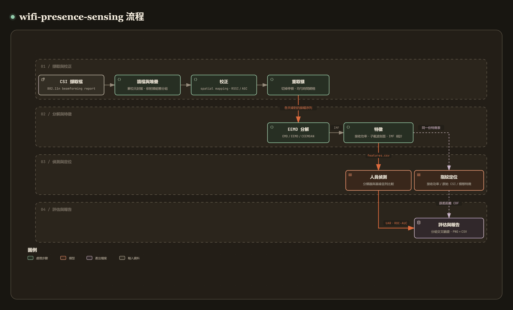

# wifi-presence-sensing

[](https://github.com/recklight/wifi-presence-sensing/actions/workflows/ci.yml)
[](https://www.python.org/downloads/)
[](LICENSE)

[English](README.md) | 繁體中文

以 WiFi 通道狀態資訊（Channel State Information, CSI）做室內人員偵測與指紋定位。

從 802.11n 網路卡記錄的原始 beamforming report 開始，一路做到人員偵測的交叉驗證與定位誤差的累積分布：解開位元封裝的 CSI、還原發射端的 spatial mapping、以 RSSI／AGC 把振幅校正到絕對尺度、把不等間隔的封包重取樣到均勻時間網格，再以總體經驗模態分解（ensemble empirical mode decomposition, EEMD）把每一組天線對的 CSI 振幅時間序列拆成本質模態函數（intrinsic mode function, IMF），從各階 IMF 抽取特徵。Python 套件叫 `wifi_presence_sensing`，命令列工具是 `wifi-presence-sensing`。

作者：RL

---

## 目錄

- [專案簡介](#專案簡介)
- [方法說明](#方法說明)
- [安裝步驟](#安裝步驟)
- [快速開始](#快速開始)
- [使用範例](#使用範例)
- [CLI 指令對照表](#cli-指令對照表)
- [專案結構](#專案結構)
- [資料準備](#資料準備)
- [設定檔](#設定檔)
- [結果與評估指標](#結果與評估指標)
- [已知限制](#已知限制)
- [設計重點](#設計重點)
- [開發與測試](#開發與測試)
- [References](#references)
- [License](#license)

---

## 專案簡介

[](https://raw.githack.com/recklight/wifi-presence-sensing/master/docs/workflow.zh-TW.html?theme=dark)

互動式流程圖：[線上瀏覽](https://raw.githack.com/recklight/wifi-presence-sensing/master/docs/workflow.zh-TW.html?theme=dark)，或在本機用瀏覽器開啟 [`docs/workflow.zh-TW.html`](docs/workflow.zh-TW.html)。可以縮放、搜尋節點，也能追蹤任兩個步驟之間的路徑。

人在房間裡移動，會改變無線訊號的多路徑結構。這個改變幾乎不會反映在 CSI 振幅的「平均值」上（有人與無人的平均振幅常常只差不到 1 dB），而是反映在振幅隨時間的**變動**：變動多大、落在哪些時間尺度、不同子載波是否同步變動。所以我以 EEMD 作為特徵抽取的骨幹：它能把非線性、非穩態的時間序列依時間尺度拆開。以 WiFi CSI 感測人體行為的整體回顧可參考 Yousefi et al.（2017）。

| 階段 | 做什麼 | 對應模組 |
| --- | --- | --- |
| 1. 讀檔 | 解析 beamforming report 的位元封裝，套用接收天線排列，處理 32-bit 時間戳記回繞 | `wifi_presence_sensing.capture` |
| 2. 堆疊 | 依射頻組態（頻寬、發射鏈數、接收鏈數）分組，拒絕把不同形狀的張量硬接在一起 | `wifi_presence_sensing.capture.trace` |
| 3. 校正 | 還原 spatial mapping、穩健估計雜訊底、以 RSSI／AGC 校正到絕對尺度、計算 effective SNR | `wifi_presence_sensing.calibrate` |
| 4. 重取樣 | 偵測停頓並切段，每段各自重取樣到均勻網格，回報有效取樣率 | `wifi_presence_sensing.calibrate.resample` |
| 5. 分解 | EMD／EEMD／CEEMDAN，停止準則可抽換 | `wifi_presence_sensing.decompose` |
| 6. 特徵 | 接收功率、時間平均振幅、子載波剖面、各階 IMF 統計量 | `wifi_presence_sensing.features` |
| 7. 偵測 | 人員偵測分類器，永遠與基線並列比較 | `wifi_presence_sensing.occupancy` |
| 8. 定位 | 三種指紋定位器（接收功率、原始 CSI、模態特徵）共用同一介面 | `wifi_presence_sensing.localize` |
| 9. 評估 | 分組分層交叉驗證、UAR／敏感度／特異度／ROC-AUC、誤差距離 CDF 與 bootstrap 信賴區間 | `wifi_presence_sensing.evaluate` |
| 10. 報告 | PNG 圖表＋同內容的 CSV、每次執行的 run manifest | `wifi_presence_sensing.report` |

---

## 方法說明

### 1. Beamforming report 的位元解封裝

擷取檔是一連串的 frame：2 位元組 big-endian 長度、1 位元組類型碼（`0xBB` 為 beamforming report）、再接 payload。Payload 的前 20 位元組是 little-endian 標頭（時間戳記、接收鏈數 $N_{rx}$、發射鏈數 $N_{tx}$、三個 RSSI、雜訊底、AGC、天線選擇、CSI 長度、速率與旗標欄位），其後是位元封裝的 CSI：30 個子載波群組，每組先跳過 3 位元，再寫入 $N_{tx}N_{rx}$ 個複數，每個複數是 8 位元有號實部加 8 位元有號虛部，LSB 在前。因為那 3 位元的位移，大部分數值都跨越位元組邊界：

$$
v = \big((b_k \gg r) \;|\; (b_{k+1} \ll (8-r))\big) \bmod 2^8,\qquad k = \lfloor p/8 \rfloor,\; r = p \bmod 8,
$$

其中 $p$ 是該數值的起始位元。`unpack_csi()` 一次算出所有數值的 $p$，以陣列運算完成整個區塊的解碼，不逐位元迴圈。CSI 長度欄位必須等於

$$
L = \left\lceil \frac{30\,(16 N_{tx} N_{rx} + 3)}{8} \right\rceil ,
$$

不符者記錄警告並跳過，截斷的 frame 也一樣，讀取器不會因一筆壞資料而中斷。天線選擇位元組解出「第 $i$ 個回報欄位來自哪一根實體天線」，讀取時一律重排回實體順序，否則「第 $k$ 組天線對」在不同封包代表不同天線。速率與旗標欄位裡的 CCK 旗標只對非 HT 訊框才讀；HT 訊框的低位元組是 MCS 編號（MCS 15 = `0x0F`）。

### 2. Spatial mapping 的還原

802.11n 發射端可在空間串流與天線之間乘上 spatial mapping 矩陣 $Q$（IEEE Std 802.11n-2009），接收端估得的通道是 $M = HQ$，因此實體通道為 $H = MQ^{-1}$。對么正矩陣 $Q^{-1} = Q^{H}$（**共軛**轉置）。以這裡採用的「發射端在前」儲存方式 $C = M^{T}$，還原式為

$$
C_{\text{true}} = Q^{-T} C = \overline{Q}\,C ,
$$

`undo_spatial_mapping()` 以一次 `numpy.einsum` 處理所有子載波與封包。共軛只在 $Q$ 是複數時才有差別：兩串流的實數 Hadamard 矩陣用一般轉置結果相同，三串流的 DFT 矩陣（元素含 $e^{\pm 2\pi i/3}$）就不同，所以測試用三串流檢查還原。非么正的矩陣則用 Moore–Penrose 虛反矩陣，並記錄警告。

### 3. 振幅校正與雜訊模型

回報的複數值大小跟著 AGC 走，而 AGC 在封包之間會跳動好幾 dB；未校正就做時間序列分解，AGC 的階梯會被當成真正的低頻模態。總接收功率由各接收鏈 RSSI 得到：

$$
P_{rx}\,[\mathrm{dBm}] = 10\log_{10}\Big(\sum_{c} 10^{\mathrm{RSSI}_c/10}\Big) - 44 - \mathrm{AGC},
$$

再把 CSI 縮放成每個子載波的平均功率等於 $P_{rx}$：

$$
s = \frac{10^{P_{rx}/10}}{\tfrac{1}{N_{sc}}\sum |C|^2},\qquad C_{\text{abs}} = \sqrt{s}\,C .
$$

若再除以雜訊功率（熱雜訊＋8 位元量化雜訊），就得到以 SNR 為單位的 CSI。RSSI 偏移量 44 dB、量化雜訊項與多發射鏈的功率修正，都採用 Linux 802.11n CSI Tool 公開的校正方式（Halperin et al., 2011）。回報的雜訊欄位本身不可靠，`NoiseModel` 提供三種策略：`reported`（原樣）、`sentinel_guard`（`-127` 換成 `-92 dBm`），以及預設的 `robust`：先同樣把 `-127` 換成 `-92 dBm`，再以 Hampel identifier（Hampel, 1974；Liu et al., 2004）把偏離中位數超過 $3.5 \times 1.4826 \times \mathrm{MAD}$ 的值換成中位數，最後夾在合理範圍內。三種策略都會回報被替換的封包比例。

### 4. Effective SNR

各子載波 SNR 的算術平均無法預測鏈路表現，因為一個深衰落子載波造成的位元錯誤遠多於強子載波省下的。Effective SNR（Halperin et al., 2010）在位元錯誤率（BER）域平均，再反解回 SNR：

$$
\gamma_{\text{eff}} = \mathrm{BER}_m^{-1}\Big(\frac{1}{K}\sum_{k=1}^{K}\mathrm{BER}_m(\gamma_k)\Big).
$$

各調變的 BER 採用未編碼 AWGN 通道下的 Gray 編碼近似式（Proakis & Salehi, 2008）：

| 調變 | BER（每符元線性 SNR $\gamma$） |
| --- | --- |
| BPSK | $Q(\sqrt{2\gamma}) = \tfrac12\,\mathrm{erfc}(\sqrt{\gamma})$ |
| QPSK | $Q(\sqrt{\gamma})$ |
| 16-QAM | $\tfrac34\,Q(\sqrt{\gamma/5})$ |
| 64-QAM | $\tfrac{7}{12}\,Q(\sqrt{\gamma/21})$ |

高 SNR 時 BER 會下溢成 0（BPSK 在 30 dB 約 $10^{-436}$），反函式隨即變成無限大。`ModulationModel` 同時提供 BER 的對數版本（`scipy.special.log_ndtr` 與其反函式 `scipy.special.ndtri_exp`），`effective_snr()` 以 log-sum-exp 在對數域平均，SNR 從 $10^{-3}$ 到 $10^{4}$ 都能精確地正反轉換（測試以相對誤差 $10^{-9}$ 檢查）。每個子載波、每個空間串流的 SNR 由線性 MMSE 接收機得到：$\gamma_s = 1/[(I + H^{H}H)^{-1}]_{ss} - 1$。

### 5. 均勻重取樣

EMD、Hilbert 轉換與所有頻譜特徵都假設等間隔取樣；封包擷取卻是毫秒級叢發夾雜數秒停頓。`resample_uniform()` 先在超過 `max_gap_s` 的停頓處切段（停頓期間的動作無從得知，不做內插），每段各自放上均勻網格：原生封包率（以中位封包間隔計）超過目標速率兩倍時，取每格內封包的平均（兼作抗混疊），否則線性內插。`sampling_diagnostics()` 回報中位與長期取樣率、Nyquist 頻率、叢發比例與停頓數，並直接說明呼吸（0.2–0.5 Hz，參見 Liu et al., 2014）、肢體動作（0.5–5 Hz）、行走 Doppler（5 Hz 以上；反射體以速度 $v$ 移動時，路徑長度變化造成 $2v/\lambda$ 的振幅起伏頻率，參見 Wang et al., 2015）在該取樣率下是否可解析。

### 6. EMD、EEMD 與 CEEMDAN

**EMD**（Huang et al., 1998）把訊號寫成 IMF 與殘差趨勢之和：

$$
x(t) = \sum_{k=1}^{K} c_k(t) + r(t).
$$

每個 IMF 以 sifting 取得：找出所有極大、極小值，各以自然三次樣條（natural cubic spline）內插成上下包絡 $e_{\max}, e_{\min}$，取 $m(t) = \tfrac12(e_{\max} + e_{\min})$，令 $h = x - m$ 並重複，直到停止準則接受。端點以鏡射極值處理（Rilling et al., 2003），避免樣條在紀錄兩端發散。停止準則可抽換：

- `ThreeThresholdStopping`（預設）：$\sigma(t) = |m(t)|/a(t)$，除了比例 $\alpha$ 的樣本外 $\sigma < \theta_1$，且處處 $\sigma < \theta_2$（$\theta_1 = 0.05$、$\theta_2 = 0.5$、$\alpha = 0.05$）；
- `CauchyStopping`：$\sum (h_{k-1}-h_k)^2 / \sum h_{k-1}^2 < 0.2$；
- `FixedIterationStopping`：固定 sifting 次數（Wu & Huang 對 EEMD 的建議）。

不論準則為何，每個 IMF 都有 `max_sift_iterations`（預設 1000）的上限，不會陷入無窮迴圈。

**EEMD**（Wu & Huang, 2009）用雜訊輔助解決 mode mixing：

$$
x_i(t) = x(t) + \varepsilon\,\sigma_x\,w_i(t),\qquad
\bar c_k(t) = \frac{1}{N}\sum_{i=1}^{N} c_k^{(i)}(t),
$$

加入的白雜訊以 $\varepsilon/\sqrt{N}$ 的速度互相抵銷。每個成員各自從 `numpy.random.SeedSequence(seed)` 衍生出的子串流取雜訊，因此結果只由 `seed` 決定，與 `n_jobs`（平行數）無關。`paired_noise` 選項同時使用 $\pm w_i$（Yeh et al., 2010），雜訊在所有模態的總和中完全抵銷。殘差定義為 $x - \sum_k \bar c_k$，所以對乾淨訊號的重建是精確的；沒有抵銷掉的雜訊另外以 `residual_noise` 回報。

**CEEMDAN**（Torres et al., 2011）逐一抽出模態，所有成員共用同一個殘差，因此分解完整、各成員的模態階數也一致。抽第 1 個模態時加入標準差為 `noise_scale` $\times\,\sigma_x$ 的白雜訊；之後抽第 $k+1$ 個模態時，加入的是雜訊的第 $k$ 個 EMD 模態 $E_k(w_i)$，先正規化成單位標準差，再乘上 `noise_scale` 與目前殘差 $r_k$ 的標準差。這沿用 Colominas et al.（2014）讓雜訊幅度隨殘差調整的作法，差別在於雜訊模態先經正規化，因此雜訊與殘差的比例不會隨高階雜訊模態變弱而縮小。

### 7. 特徵

每個時間視窗產生四組具名特徵，模型以前綴宣告它用哪些證據：

| 前綴 | 內容 |
| --- | --- |
| `power__` | 各接收鏈與總接收功率的平均與標準差 |
| `response__` | 每個（天線對、子載波）的時間平均 dB 振幅，以及整體平均 `response__mean_db` |
| `profile__` | 每組天線對的時間標準差（平均／最大）、頻率選擇性、頻譜範圍、子載波間的平均相關 |
| `modal__` | 每組天線對的子載波先以 PCA 第一主成分合成一條序列，經 EEMD 後各階 IMF 的變異數、能量佔比、以瞬時功率（振幅平方）加權的平均瞬時頻率（Hilbert 轉換）、過零率，以及殘差趨勢斜率 |

### 8. 人員偵測與指紋定位

`OccupancyClassifier` 是 scikit-learn（Pedregosa et al., 2011）estimator：選取特徵群組、標準化、再接 logistic regression／random forest／SVM／MLP 其中之一（另有只做多數決的 `majority`）。評估時一律與三個對照並列：多數類別投票（`majority`）、只用平均振幅單一特徵的 logistic regression（`mean_amplitude`）、以及和分類器同一種模型（`occupancy.model`）但只用時間平均振幅的版本（`raw_response`）。

指紋定位建立 radio map（每個參考位置的特徵平均與離散度），以兩種方式比對：

- `knn`：在訊號空間找最近的參考點（RADAR，Bahl & Padmanabhan, 2000），每個特徵以「同一位置內的合併標準差」為單位，鄰居權重為 $\exp\!\big(-\tfrac12(d_j^2 - d_{\min}^2)\big)$；
- `probabilistic`：每個參考位置的每個特徵視為獨立高斯，取後驗加權位置（沿用 Horus，Youssef & Agrawala, 2005 的機率式比對）。

被定位的人身上不帶任何裝置：radio map 是讓人站在固定收發端之間的各參考位置量得，屬於 device-free 的 CSI 指紋定位（Xiao et al., 2013 的 Pilot）。用各子載波的 CSI 振幅、而不是單一接收功率當作指紋，則是 FIFS（Xiao et al., 2012）的作法；同樣以 PHY 層 CSI 定位的還有 FILA（Wu et al., 2012）與 Sen et al.（2012）。

三個定位器 `ReceivedPowerLocator`（`power`）、`RawResponseLocator`（`response`）、`ModalResponseLocator`（`modal`＋`profile`）共用同一演算法，只差在看到的特徵，因此比較結果直接反映特徵本身的價值。

---

## 安裝步驟

需求：Python 3.10 以上（3.10–3.13 皆可）。

```bash
git clone https://github.com/recklight/wifi-presence-sensing.git
cd wifi-presence-sensing
python -m venv .venv
source .venv/bin/activate          # Windows: .venv\Scripts\activate
pip install -e .                   # 核心相依：numpy scipy scikit-learn pandas matplotlib pyyaml typer joblib
pip install -e ".[dev]"            # 另加 pytest、hypothesis、ruff
```

所有訊號處理都以 NumPy／SciPy 實作，擷取檔的二進位格式以標準函式庫 `struct` 與 NumPy 解析。

不安裝也能直接從原始碼執行：把 `src` 加進 `PYTHONPATH`，再把下文所有的 `wifi-presence-sensing` 換成 `python -m wifi_presence_sensing`，例如：

```bash
PYTHONPATH=src python -m wifi_presence_sensing --help        # Windows PowerShell: $env:PYTHONPATH="src"
```

---

## 快速開始

不需要任何量測資料，先用模擬擷取檔走完整條流程：

```bash
wifi-presence-sensing synthesize data/synthetic/occupancy --sessions 4 --duration 40
wifi-presence-sensing prepare --dataset data/synthetic/occupancy/manifest.yaml --config configs/quick_demo.yaml --out outputs/demo
wifi-presence-sensing evaluate outputs/demo/features.csv --config configs/quick_demo.yaml
```

或執行完整示範腳本（約一分鐘，含偵測與定位）：

```bash
python examples/end_to_end_synthetic.py --output examples/output
```

模擬資料中的人對通道的影響刻意設得很明顯，示範結果只代表「程式可以正確運作」，不代表真實房間能達到的準確度。

---

## 使用範例

### CLI

```bash
# 1. 檢視擷取檔：封包數、射頻組態、取樣率能解析什麼、雜訊欄位品質、effective SNR
wifi-presence-sensing inspect data/raw/session1/occupied.dat

# 2. 依資料集 manifest 建立特徵表（校正 → 重取樣 → 切視窗 → EEMD → 特徵）
#    my_office.yaml 是你為自己的擷取檔寫的 manifest，格式見 configs/datasets/example_occupancy.yaml
wifi-presence-sensing prepare --dataset configs/datasets/my_office.yaml --out outputs/office

# 3. 分組交叉驗證：提出的模型與三個基線並列
wifi-presence-sensing evaluate outputs/office/features.csv --set evaluation.group_by=session

# 4. 以全部資料訓練並存檔，再對新資料推論
wifi-presence-sensing train outputs/office/features.csv --model-out outputs/office/model.joblib
wifi-presence-sensing predict outputs/office/model.joblib outputs/new_day/features.csv --out outputs/new_day/predictions.csv

# 5. 指紋定位：三個定位器的誤差距離 CDF
wifi-presence-sensing localize outputs/grid/features.csv --set localization.method=probabilistic

# 6. 單一天線對的 EEMD 分解與圖表
wifi-presence-sensing decompose data/raw/session1/occupied.dat --stream tx0rx1
```

任何設定都可用 `--set 區段.鍵=值` 臨時覆寫，例如 `--set decomposition.n_ensemble=100`。

### Python API

```python
from wifi_presence_sensing import (
    Config, DatasetManifest, read_beamform_file, stack_snapshots,
    standard_mapping_matrix, undo_spatial_mapping, to_calibrated_csi,
    amplitude_db, decompose_eemd,
)
from wifi_presence_sensing.pipeline import build_dataset, evaluate_occupancy, occupancy_summary

# 低階：讀檔、還原 spatial mapping、校正、對一條振幅序列做 EEMD
snapshots, stats = read_beamform_file("data/raw/session1/occupied.dat")
trace, report = stack_snapshots(snapshots, tx_policy="dominant")
# 只有在確知發射端用了這個 spatial mapping 時才需要還原（設定檔預設為 none）
csi = undo_spatial_mapping(trace.csi, standard_mapping_matrix(trace.n_tx))
calibrated = to_calibrated_csi(csi, trace.rssi_db, trace.agc_db)      # 絕對尺度（sqrt(mW)）
series = amplitude_db(calibrated)[:, 0, 0, :].mean(axis=1)            # tx0-rx0 的子載波平均
result = decompose_eemd(series, n_ensemble=100, noise_scale=0.2, seed=42)
print(result.imfs.shape, abs(result.reconstruct() - series).max())

# 高階：整個資料集 → 特徵表 → 分組交叉驗證
config = Config.from_yaml("configs/default.yaml").override({"decomposition.n_ensemble": 20})
manifest = DatasetManifest.from_yaml("configs/datasets/my_office.yaml")
table, details = build_dataset(manifest, config)
reports = evaluate_occupancy(table, config)
print(occupancy_summary(reports))
```

（上例的時間序列未經均勻重取樣，僅示範 API；實際分析請走 `build_dataset()`，它會先依停頓切段並重取樣。）

---

## CLI 指令對照表

| 指令 | 用途 | 主要輸出 |
| --- | --- | --- |
| `wifi-presence-sensing inspect CAPTURE...` | 解析擷取檔，回報封包、射頻組態、取樣率限制、雜訊欄位與 effective SNR | `inspection.json`、每個擷取檔的封包間隔直方圖（`<檔名>_intervals.png`）與其資料（`<檔名>_intervals.csv`）；檔名重複時前面加上資料夾名稱，例如 `session1_occupied_intervals.png` |
| `wifi-presence-sensing synthesize DIR` | 產生模擬擷取檔與資料集 manifest（不含任何真實資料） | `*.dat`、`manifest.yaml` |
| `wifi-presence-sensing prepare --dataset M` | 由資料集 manifest 建立特徵表 | `features.csv` |
| `wifi-presence-sensing prepare --table CSV` | 由振幅表 CSV 建立特徵表 | `features.csv`（遮罩比例記在 `manifest.json`） |
| `wifi-presence-sensing decompose CAPTURE` | 單一天線對的 EMD／EEMD／CEEMDAN | `imfs.csv`、`mode_statistics.json`、分解圖 |
| `wifi-presence-sensing train FEATURES` | 以整份特徵表訓練人員偵測分類器並存檔 | 模型檔 `*.joblib`（內含完整設定與類別） |
| `wifi-presence-sensing evaluate FEATURES` | 分組分層交叉驗證，與基線並列比較 | `summary.csv`、`metrics.json`、每個模型的混淆矩陣圖與同內容的 `confusion_<模型>.csv`、`out_of_fold_predictions.csv` |
| `wifi-presence-sensing predict MODEL FEATURES` | 以存檔模型推論 | 預測與各類別機率的 CSV 檔 |
| `wifi-presence-sensing localize FEATURES` | 三個指紋定位器的分組交叉驗證 | `error_cdf.csv`、`error_curve.csv`、`error_cdf.png`、`estimates.csv`（每個視窗的真實與估計位置，以 `recording` 與 `window_start_s` 對應 `features.csv` 的列）、`metrics.json` |

各指令接受的選項：

| 選項 | 適用指令 | 說明 |
| --- | --- | --- |
| `--config/-c PATH` | `inspect`、`prepare`、`decompose`、`train`、`evaluate`、`localize` | YAML 設定檔；未指定時使用內建預設值（與 `configs/default.yaml` 相同） |
| `--set/-s 區段.鍵=值` | 同上 | 覆寫單一設定，可重複 |
| `--out/-o DIR` | `inspect`、`prepare`、`decompose`、`evaluate`、`localize` | 輸出資料夾；未指定時在 `output.root`（預設 `outputs/`）下建立帶時間戳記的資料夾。資料夾內一律另有 `config.yaml` 與 `manifest.json` |
| `--out/-o FILE` | `predict` | 預測 CSV 的檔名（預設為 `output.root` 下的 `predictions.csv`，`output.root` 取自訓練時存進模型檔的設定） |
| `--model-out/-m FILE` | `train` | 模型檔名（預設為 `output.root` 下的 `occupancy_model.joblib`） |
| `--dataset/-d`、`--table/-t` | `prepare` | 資料來源：資料集 manifest 或振幅表 CSV，二擇一；都不給時使用設定檔的 `dataset` |
| `--stream` | `decompose` | 要分解的天線對，例如 `tx0rx1` |
| `--kind`、`--sessions`、`--duration`、`--rate`、`--seed` | `synthesize` | 模擬的任務（`occupancy`／`localization`）、場次數、每段秒數、封包率與亂數種子 |

輸入有誤（找不到檔案、擷取檔沒有可解碼的封包、資料不足以做指定的分組切分等）時，指令以一行錯誤訊息結束並回傳非零的結束碼，不會印出 traceback；把 `log_level` 設為 `DEBUG` 可在記錄中看到完整的 traceback。

---

## 專案結構

```text
wifi-presence-sensing/
├── pyproject.toml
├── README.md                      # 英文說明
├── README.zh-TW.md                # 繁體中文說明
├── LICENSE
├── .gitignore                     # 量測資料、執行結果與模型檔一律不納入版本控制
├── configs/
│   ├── default.yaml               # 所有設定的預設值與說明
│   ├── quick_demo.yaml            # 模擬資料的快速設定
│   ├── amplitude_table.yaml       # 振幅表 CSV 的設定
│   └── datasets/
│       ├── example_occupancy.yaml     # 人員偵測 manifest 範本
│       └── example_localization.yaml  # 定位 manifest 範本
├── data/
│   ├── raw/                       # 你的擷取檔（不納入版本控制）
│   └── interim/
├── docs/
│   ├── images/workflow.png        # README.md 的流程圖
│   ├── images/workflow.zh-TW.png  # README.zh-TW.md 的流程圖
│   ├── workflow.html              # 英文版互動式流程圖（瀏覽器開啟）
│   └── workflow.zh-TW.html        # 繁體中文版互動式流程圖
├── examples/
│   └── end_to_end_synthetic.py    # 只用模擬資料的端到端示範
├── outputs/                       # 執行結果（不納入版本控制）
├── src/wifi_presence_sensing/
│   ├── __init__.py                # 公開 API
│   ├── __main__.py                # python -m wifi_presence_sensing
│   ├── py.typed                   # 宣告套件附有型別註記（PEP 561）
│   ├── config.py                  # dataclass 設定與驗證
│   ├── pipeline.py                # 擷取檔 → 特徵表 → 評估
│   ├── cli.py                     # typer CLI
│   ├── synthetic.py               # 模擬擷取檔與振幅表
│   ├── logging_utils.py           # logging 設定
│   ├── capture/                   # 讀檔與資料描述
│   │   ├── beamform_report.py     # beamforming report 解析／寫出
│   │   ├── rate_flags.py          # 速率與旗標欄位解碼
│   │   ├── snapshot.py            # ChannelSnapshot、RadioMeta
│   │   ├── trace.py               # 依射頻組態堆疊成 ChannelTrace
│   │   ├── subcarriers.py         # 20/40 MHz 子載波對照
│   │   ├── timeline.py            # 時間戳記回繞、停頓偵測、取樣診斷
│   │   ├── tabular_reader.py      # 振幅表 CSV 讀取與驗證
│   │   └── dataset.py             # 資料集 manifest
│   ├── calibrate/
│   │   ├── spatial_mapping.py     # spatial mapping 還原
│   │   ├── scaling.py             # RSSI/AGC 絕對校正、相位去趨勢
│   │   ├── noise_model.py         # 雜訊底的穩健估計
│   │   ├── link_quality.py        # BER 與 effective SNR
│   │   └── resample.py            # 均勻重取樣
│   ├── decompose/
│   │   ├── sifting.py             # 極值、包絡、sifting
│   │   ├── stopping.py            # 停止準則
│   │   ├── emd.py
│   │   ├── eemd.py
│   │   └── ceemdan.py
│   ├── features/
│   │   ├── modal_statistics.py    # 各階 IMF 的統計量
│   │   ├── subcarrier_profile.py  # 子載波剖面特徵與子載波合成
│   │   └── extraction.py          # 視窗化與 FeatureTable
│   ├── occupancy/
│   │   └── classifier.py          # 人員偵測分類器與基線
│   ├── localize/
│   │   ├── fingerprint.py         # 三種定位器
│   │   └── benchmark.py
│   ├── evaluate/
│   │   ├── splitting.py           # 分組（分層）切分
│   │   ├── crossval.py            # 交叉驗證與巢狀搜尋
│   │   ├── metrics.py
│   │   └── error_cdf.py
│   └── report/
│       ├── figures.py             # 圖表與對應的資料表
│       └── manifest.py            # run manifest
└── tests/                         # pytest，全部使用程式合成的 fixture
```

（每個子套件另有 `__init__.py`，上圖省略。）

---

## 資料準備

本專案**不附任何量測資料**，請自行準備並放在 `data/raw/`（或任何位置，再以設定檔指過去）。`data/raw/` 已列入 `.gitignore`。

### 1. 擷取檔（建議）

以 Linux 802.11n CSI Tool（Halperin et al., 2011）在 Intel 5300 網路卡上記錄的 beamforming report 二進位檔（通常副檔名為 `.dat`）。格式見[方法說明](#1-beamforming-report-的位元解封裝)；20 MHz 與 40 MHz 的擷取檔可以分別分析，但不能混在同一個資料集裡（同一個「第 k 個子載波群組」在兩種頻寬下是不同的實體頻率）。

接著為資料集寫一份 manifest（參考 `configs/datasets/example_occupancy.yaml`），例如存成 `configs/datasets/my_office.yaml`；`configs/datasets/` 底下除了兩份 `example_*.yaml` 範本，其他 manifest 都不納入版本控制。每個錄製檔都要寫明標籤與所屬場次（session），定位用的還要加上真實位置；`path`、`label`、`session` 缺一不可，這些都不會從檔名推斷：

```yaml
name: my-office
description: 辦公室，無人／有人，三個場次
recordings:
  - path: ../../data/raw/session1/empty.dat
    label: empty
    session: session1
  - path: ../../data/raw/session1/occupied.dat
    label: occupied
    session: session1
    position: [3.0, 2.5]      # 定位任務才需要，單位公尺
```

相對路徑以 manifest 所在資料夾為基準（上例從 `configs/datasets/` 指到 `data/raw/`），或在設定檔以 `data_root` 指定基準資料夾。**同一類別至少要有和交叉驗證折數一樣多的場次**；只有一個場次時，可以用 `evaluation.group_by: block`，把長錄製檔切成不重疊的時間區塊當作分組（跨越區塊邊界的視窗會被捨棄，`out_of_fold_predictions.csv`、`estimates.csv` 只列出保留的視窗，捨棄的數量記在 `manifest.json`）。是否跨越邊界，看的是特徵表本身記錄的視窗長度（`features.csv` 的 `window_s` 欄），不是評估時設定檔裡的 `features.window_s`。

### 2. 振幅表 CSV（替代來源）

若資料已經匯出成無表頭的數值表：每列一個封包，前幾欄是整數標籤，其後是 $N_{\text{streams}} \times N_{\text{subcarriers}}$ 個 dB 振幅（預設 6 × 30，依天線對排列）。表格沒有記錄每個天線對對應哪一組實體天線，因此特徵名稱中的天線對一律記為 `stream0`、`stream1`…。在 `configs/amplitude_table.yaml` 設定欄位結構、哨兵值（預設 65535）、合理 dB 範圍與每列的名目取樣率，然後：

```bash
wifi-presence-sensing prepare --table data/raw/amplitude_table.csv --config configs/amplitude_table.yaml
```

讀取時會驗證欄數與數值格式，哨兵值與超出範圍的數值會被遮罩並回報比例（每個天線對各遮了多少、影響幾列），再於同一段連續列（同一組標籤）之內沿時間內插補值，不會跨段。只有某個（天線對、子載波）在整段都被遮罩、段內沒有值可以內插時，才以整張表該欄的中位數補上；這個中位數會用到其他段的資料，所以會記錄警告與補值的數量。表格沒有表頭，哪一個標籤欄才是類別只有你知道，請用 `label_column` 指定（從 0 起算，預設 0）。

---

## 設定檔

所有可調參數都在 `configs/default.yaml`，每一項都有註解。重點：

| 區段 | 重點設定 |
| --- | --- |
| `capture` | `tx_policy`（`dominant`／`first_chain`）、`bandwidth_mhz` |
| `calibration` | `spatial_mapping`（`none`／`identity`／`hadamard`／`fourier`／`phases`）、`noise_strategy` |
| `resample` | `rate_hz`（不要高於擷取的長期封包率）、`max_gap_s` |
| `decomposition` | `method`、`n_ensemble`、`noise_scale`、`stopping`、`max_sift_iterations` |
| `features` | `window_s`、`hop_s`、`stream_reduction`、`block_s`、`n_jobs` |
| `table` | 振幅表的 `path`、`label_column`、`n_streams`、`sentinel_values`、`valid_range_db`、`nominal_rate_hz` |
| `occupancy` | `model`、`feature_groups`、`positive_label` |
| `evaluation` | `n_splits`、`group_by`（`recording`／`session`／`block`）、`nested_search` |
| `localization` | `method`、`n_neighbors`、`cdf_thresholds_m`、`n_bootstrap`、`group_by` |
| `output` | `root`（未指定 `--out` 時的輸出根目錄）、`figure_format`（`png`／`pdf`／`svg`） |

設定檔中未知的鍵、型別不對的值（例如次數寫成 `2.5`、長度寫成 `true`）與超出範圍的值都會被直接拒絕；選項類的設定寫錯時，錯誤訊息會列出可用的選項。

---

## 結果與評估指標

`inspect`、`prepare`、`decompose`、`evaluate`、`localize` 都會在輸出資料夾寫入 `config.yaml`（實際使用的完整設定）與 `manifest.json`（輸入檔的 SHA-256、seed、套件與函式庫版本、git commit、UTC 時間，以及被跳過的封包數、被替換的雜訊值比例、被遮罩的振幅比例等細節）；`train` 則把完整設定、類別與使用的特徵存進模型檔本身。每張圖都附有同內容的 CSV，可以直接 diff 或重畫。

### 人員偵測（`evaluate`）

| 指標 | 說明 |
| --- | --- |
| UAR | 各類別召回率的平均（balanced accuracy），不受類別比例影響；**主要指標** |
| 敏感度／特異度 | 以 `positive_label`（預設 `occupied`）為正類；多類別時逐類別 one-vs-rest |
| Macro precision／recall／F1 | 各類別等權平均 |
| 混淆矩陣 | 列為真實類別、欄為預測類別，圖中同時標出筆數與列召回率 |
| ROC-AUC（Fawcett, 2006） | 二元時為正類 AUC；多類別時為各類別 one-vs-rest AUC 的未加權平均（macro） |

`summary.csv` 同時列出「pooled」（所有 out-of-fold 預測合併計算）與「fold 平均 ± 標準差」。兩者都有意義，但多數類別投票這類模型在 pooled 時可能低於 0.5（每折的多數類別不同），因此判讀以 fold 平均為主。交叉驗證一律分組：同一場次（或同一錄製檔、同一時間區塊）的視窗不會同時出現在訓練與測試集；開啟 `nested_search` 時，正規化強度（regularization，random forest 則為樹的數量）在每個外層訓練折內再以分組內層交叉驗證挑選，回報的分數因此不會沾到調參的光（Varma & Simon, 2006）。

### 指紋定位（`localize`）

- 誤差距離的經驗 CDF：完整的階梯曲線（`error_curve.csv`，即每個視窗的原始誤差距離），加上在 `cdf_thresholds_m`（預設 1–8 公尺）上的值（`error_cdf.csv`）；
- 每個門檻的百分位 bootstrap 95% 信賴區間（Efron, 1979）；
- 樣本數 `n_samples` 與超出最大門檻的樣本比例 `fraction_beyond_max`，表列的曲線停在 1.0 以下就是因為後者；
- 平均、中位數、第 90 百分位、RMSE 與最大誤差；
- 每條曲線的 SHA-256 摘要；若兩個定位器的誤差向量逐位元相同，會發出警告並記錄在 `metrics.json` 的 `duplicates`。

---

## 已知限制

- 取樣率決定能感測什麼。若擷取時的長期封包率只有約 1 Hz，Nyquist 頻率只有 0.5 Hz：行走 Doppler 完全無法解析，連呼吸都落在 Nyquist 邊緣。`inspect` 會對每個擷取檔明確列出這一點；請以足夠高的封包率擷取（數十 Hz 以上），再把 `resample.rate_hz` 設在長期封包率以下。
- 每個類別都只在一個場次錄製時，場次本身就是混淆變因：分類器可能學到的是「那一天的房間」而不是「有沒有人」。請在多個場次、交替記錄各類別。
- 雜訊欄位不可靠。若 `inspect` 回報被替換的雜訊值比例很高，以 SNR 為基礎的量（effective SNR）在該檔案上僅供參考；振幅特徵本身不受影響。
- Spatial mapping 矩陣依硬體而定，預設不做還原（`none`）。若發射端使用了特定的 mapping，請以 `calibration.spatial_mapping` 指定，或以 `phases` 提供相位表。還原需要完整的 $N_{tx} \times N_{rx}$ 張量，因此設定檔會拒絕把它與 `capture.tx_policy: first_chain` 一起使用。
- `first_chain` 只是折衷。它保留每個封包的第 0 條發射鏈，不丟封包；但多發射鏈的封包把發射功率分給各鏈，校正後第 0 條鏈的振幅在單鏈與多鏈封包之間只能近似比較。大多數封包的發射鏈數相同時，請用預設的 `dominant`。
- `train` 寫出的模型檔是 joblib（pickle）格式，載入時可以執行任意程式碼。`predict` 只拿自己訓練的模型檔來用。
- `synthetic.py` 的通道模型刻意簡化，只用來檢查程式，在模擬資料上得到的分數都不構成研究結論。

---

## 設計重點

### 資料讀取

- 擷取檔直接從二進位讀起，以向量化方式解位元封裝。CSI 長度不符與截斷的 frame 記錄後跳過，跳過的數量寫進 manifest。
- 天線選擇欄位在同一個檔案內就會變動，所以每個封包都依它重排回實體天線順序，「第 k 組天線對」才會一直指同一對天線。
- 32-bit 時間戳記在讀取時展開。相鄰封包的間隔若往回超過半個計數週期（約 35.8 分鐘）就是回繞，所以跨越回繞的紀錄不會算出負的持續時間。往前的間隔若離一整個週期不到 1 秒，就是剛好跨過回繞的晚到封包，只當成順序錯亂，不會被當成第二次回繞。其他間隔都不動，長時間的停頓仍然是停頓。只有一種情況單靠計數器分不出來：超過 35.8 分鐘、中間又遇到回繞的停頓，這時 log 會記成順序錯亂。
- 單一發射鏈的封包保留 `(1, n_rx, 30)` 形狀。不同頻寬、不同發射鏈數的封包不硬接在一起，由 `tx_policy` 決定怎麼處理。
- 振幅表裡一個 65535 之類的哨兵值，就足以把某個天線對的平均拉高數十 dB、標準差放大數百倍，所以讀取時先驗證欄位，再遮罩哨兵值與超出範圍的值並回報比例。

### 時間序列與分解

- 封包不等間隔、又夾雜長停頓，直接當成等間隔序列分解的話，封包的時間分布本身就會被拆成模態，所以先在停頓處切段、每段各自重取樣，並回報有效取樣率與能解析的動作頻帶（約 1 Hz 的封包率連呼吸都只在 Nyquist 邊緣）。
- EMD／EEMD／CEEMDAN 都在套件內實作：鏡射端點、可抽換的停止準則、sifting 次數上限、重建檢查，亂數結果與 `n_jobs` 無關。

### 評估

- 時間上相鄰的視窗幾乎一模一樣，隨機切分會嚴重高估準確率，所以交叉驗證一律分組：以場次、錄製檔或不重疊的時間區塊分組，seed 固定，可選巢狀交叉驗證；振幅表的每一段連續列自成一組。
- 分類結果永遠和多數類別投票、單一平均振幅特徵、原始振幅特徵這幾個基線並列，模態特徵有沒有加值一看就知道。
- 讀不同特徵群組的定位器若算出逐位元相同的誤差向量，多半是比較流程接錯了（例如兩個都讀到同一組欄位），所以每條曲線都算 SHA-256，相同時發出警告並記在 `metrics.json`。

### 工程

特徵表要事後還查得出是用哪一組校正、重取樣與 EEMD 設定做出來的，留著才有意義。所以參數都放在 frozen dataclass 裡，以 YAML 讀寫，每個執行資料夾（`--out`，或 `output.root` 底下新建的資料夾）都附上當次的設定與 run manifest。鍵打錯、次數寫成小數、開關寫成字串都會直接報錯，不會默默套用。命令列用 typer，進度與警告走 logging；每張圖（PNG、PDF 或 SVG）旁邊都有一份同內容的 CSV。

測試只用程式合成的資料。位元解碼拿去和一份獨立、刻意寫成逐位元迴圈的參考實作比對；其餘涵蓋 spatial mapping 往返、BER 往返、分解重建、分組切分不洩漏與 CLI 端到端流程。Python 3.10 是下限：測試檢查 3.10 語法、3.11 以後才有的標準函式庫名稱與 NumPy 2.0 移除的別名，相依套件的下限（`numpy>=1.24` 等）在 3.10 都裝得起來。CI 在 Linux 與 Windows 上跑 Python 3.10–3.13，另外用最舊的相依版本跑一次。公開函式都有 type hints 與英文 numpy 風格 docstring。

---

## 開發與測試

```bash
pip install -e ".[dev]"
PYTHONPATH=src python -m pytest -q        # 單元測試＋docstring 範例
python -m ruff check .
python -m ruff format --check .
```

`tests/test_property_based.py` 需要 hypothesis，`dev` extra 已經包含（只要 pytest 與 hypothesis 的話用 `pip install -e ".[test]"`）；未安裝時整個檔案會被標示為略過（skipped）。它檢查的三個性質（spatial mapping 往返、位元封裝往返、BER 對數域往返）在其他測試中也以多組 seed 或密集的 SNR 網格檢查過。

---

## References

### Empirical mode decomposition

- N. E. Huang, Z. Shen, S. R. Long, M. C. Wu, H. H. Shih, Q. Zheng, N.-C. Yen, C. C. Tung, H. H. Liu, "The empirical mode decomposition and the Hilbert spectrum for nonlinear and non-stationary time series analysis," *Proceedings of the Royal Society of London A*, 454(1971):903–995, 1998.
- Z. Wu, N. E. Huang, "Ensemble Empirical Mode Decomposition: A Noise-Assisted Data Analysis Method," *Advances in Adaptive Data Analysis*, 1(1):1–41, 2009.
- G. Rilling, P. Flandrin, P. Gonçalves, "On Empirical Mode Decomposition and its Algorithms," *IEEE-EURASIP Workshop on Nonlinear Signal and Image Processing (NSIP)*, 2003.
- M. E. Torres, M. A. Colominas, G. Schlotthauer, P. Flandrin, "A Complete Ensemble Empirical Mode Decomposition with Adaptive Noise," *IEEE International Conference on Acoustics, Speech and Signal Processing (ICASSP)*, pp. 4144–4147, 2011.
- M. A. Colominas, G. Schlotthauer, M. E. Torres, "Improved complete ensemble EMD: A suitable tool for biomedical signal processing," *Biomedical Signal Processing and Control*, 14:19–29, 2014.
- J.-R. Yeh, J.-S. Shieh, N. E. Huang, "Complementary Ensemble Empirical Mode Decomposition: A Novel Noise Enhanced Data Analysis Method," *Advances in Adaptive Data Analysis*, 2(2):135–156, 2010.

### 802.11n channel state information

- D. Halperin, W. Hu, A. Sheth, D. Wetherall, "Tool Release: Gathering 802.11n Traces with Channel State Information," *ACM SIGCOMM Computer Communication Review*, 41(1):53, 2011.
- D. Halperin, W. Hu, A. Sheth, D. Wetherall, "Predictable 802.11 Packet Delivery from Wireless Channel Measurements," *ACM SIGCOMM*, pp. 159–170, 2010.
- IEEE Std 802.11n-2009, "Amendment 5: Enhancements for Higher Throughput," IEEE Standard for Information Technology — Telecommunications and Information Exchange Between Systems — Local and Metropolitan Area Networks.
- J. G. Proakis, M. Salehi, *Digital Communications*, 5th ed., McGraw-Hill, 2008.

### Indoor localization and sensing

- P. Bahl, V. N. Padmanabhan, "RADAR: An In-Building RF-based User Location and Tracking System," *IEEE INFOCOM*, pp. 775–784, 2000.
- M. Youssef, A. Agrawala, "The Horus WLAN Location Determination System," *ACM MobiSys*, pp. 205–218, 2005.
- J. Xiao, K. Wu, Y. Yi, L. M. Ni, "FIFS: Fine-Grained Indoor Fingerprinting System," *IEEE International Conference on Computer Communications and Networks (ICCCN)*, 2012.
- K. Wu, J. Xiao, Y. Yi, M. Gao, L. M. Ni, "FILA: Fine-grained Indoor Localization," *IEEE INFOCOM*, pp. 2210–2218, 2012.
- J. Xiao, K. Wu, Y. Yi, L. Wang, L. M. Ni, "Pilot: Passive Device-Free Indoor Localization Using Channel State Information," *IEEE International Conference on Distributed Computing Systems (ICDCS)*, pp. 236–245, 2013.
- S. Sen, B. Radunovic, R. R. Choudhury, T. Minka, "You are Facing the Mona Lisa: Spot Localization using PHY Layer Information," *ACM MobiSys*, pp. 183–196, 2012.
- W. Wang, A. X. Liu, M. Shahzad, K. Ling, S. Lu, "Understanding and Modeling of WiFi Signal Based Human Activity Recognition," *ACM MobiCom*, pp. 65–76, 2015.
- X. Liu, J. Cao, S. Tang, J. Wen, "Wi-Sleep: Contactless Sleep Monitoring via WiFi Signals," *IEEE Real-Time Systems Symposium (RTSS)*, pp. 346–355, 2014.
- S. Yousefi, H. Narui, S. Dayal, S. Ermon, S. Valaee, "A Survey on Behavior Recognition Using WiFi Channel State Information," *IEEE Communications Magazine*, 55(10):98–104, 2017.

### Statistics and evaluation

- F. R. Hampel, "The Influence Curve and Its Role in Robust Estimation," *Journal of the American Statistical Association*, 69(346):383–393, 1974.
- H. Liu, S. Shah, W. Jiang, "On-line Outlier Detection and Data Cleaning," *Computers and Chemical Engineering*, 28(9):1635–1647, 2004.
- B. Efron, "Bootstrap Methods: Another Look at the Jackknife," *The Annals of Statistics*, 7(1):1–26, 1979.
- T. Fawcett, "An introduction to ROC analysis," *Pattern Recognition Letters*, 27(8):861–874, 2006.
- S. Varma, R. Simon, "Bias in Error Estimation When Using Cross-Validation for Model Selection," *BMC Bioinformatics*, 7:91, 2006.
- F. Pedregosa, G. Varoquaux, A. Gramfort, V. Michel, B. Thirion, O. Grisel, et al., "Scikit-learn: Machine Learning in Python," *Journal of Machine Learning Research*, 12:2825–2830, 2011.

---

## License

MIT License，Copyright (c) RL。詳見 [LICENSE](LICENSE)。
